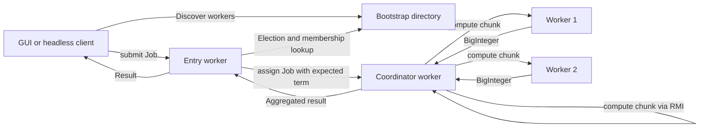
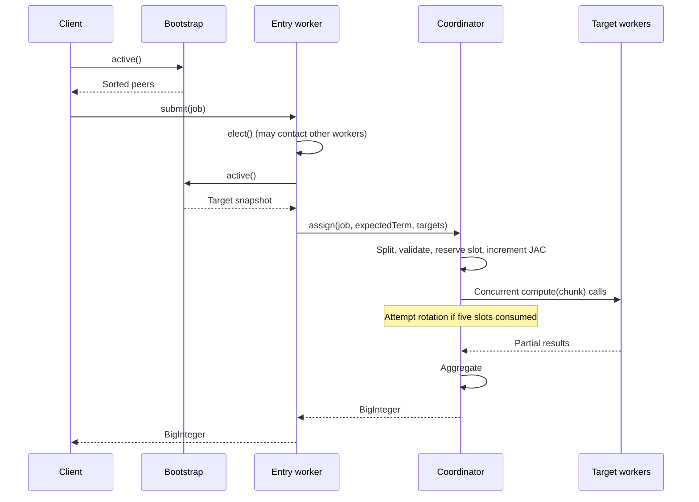

# Backend manual: CS324 distributed job system

This manual explains the implementation in this working tree, inspected on 29 September 2026. Start with sections 1–5 for the overall design, then study the election and admission sections alongside `WorkerNode.java`. Paths in this document link to the actual source.

## Contents

1. [What the backend does](#1-what-the-backend-does)
2. [Source map and reading order](#2-source-map-and-reading-order)
3. [RMI and the data contracts](#3-rmi-and-the-data-contracts)
4. [Startup and membership](#4-startup-and-membership)
5. [A complete job journey](#5-a-complete-job-journey)
6. [Election and coordinator agreement](#6-election-and-coordinator-agreement)
7. [Admission, counters, and rotation](#7-admission-counters-and-rotation)
8. [Splitting and calculations](#8-splitting-and-calculations)
9. [Concurrency and locking](#9-concurrency-and-locking)
10. [Failures and retries](#10-failures-and-retries)
11. [Client input and backend integration](#11-client-input-and-backend-integration)
12. [Build and run](#12-build-and-run)
13. [Tests and troubleshooting](#13-tests-and-troubleshooting)
14. [Limitations and extension points](#14-limitations-and-extension-points)
15. [Check your understanding](#15-check-your-understanding)

## 1. What the backend does

The project distributes integer calculations across Java processes. It uses **Java 21, Java RMI, and Maven**, with JUnit 5 for tests. There are no application runtime dependencies beyond the JDK. It has no HTTP endpoints, REST controllers, application database, or persistent job queue.

There are three process roles:

| Role | Responsibility |
|---|---|
| Bootstrap | Maintains the membership directory, checks reachability, and introduces neighbouring workers. |
| Worker | Participates in elections, accepts chunk computations, and can become coordinator. |
| Client | Parses input, submits a job through a worker, and receives one result or failure. |

**Coordinator is a temporary role held by a worker**, not an extra server. The coordinator splits a submitted job, schedules chunks, waits for their results, and aggregates them.



The diagram illustrates a job whose chunks include the coordinator. When there are fewer chunks than workers, the coordinator might receive no chunk itself.

The supported jobs are:

| Type | Input | Output | Example |
|---|---|---|---|
| `MAX` | Nonempty integer list | Largest value | `[-9,42,7,-1]` → `42` |
| `PRIMECOUNT` | Integer list, possibly empty | Number of prime occurrences | `[2,2,3,4,5,-7,1]` → `4` |
| `PRIMESUM` | Inclusive integer range | Sum of primes in that range | `[1,10]` → `17` |

`PRIMECOUNT` counts duplicates separately. Negative numbers, zero, and one are not prime. Inputs use signed 32-bit integers; results use `BigInteger`.

## 2. Source map and reading order

All production Java files are under `src/main/java/edu/usp/cs324/`.

| File/package | What to learn from it |
|---|---|
| [pom.xml](../pom.xml) | Java release, test dependency, build plugins, integration profile. |
| [api/Job.java](../src/main/java/edu/usp/cs324/api/Job.java) | Input representation and validation. |
| [api/WorkerRemote.java](../src/main/java/edu/usp/cs324/api/WorkerRemote.java) | Operations workers expose over RMI. |
| [api/BootstrapRemote.java](../src/main/java/edu/usp/cs324/api/BootstrapRemote.java) | Membership operations. |
| [api/Peer.java](../src/main/java/edu/usp/cs324/api/Peer.java) | Endpoint identity and worker lookup. |
| [network/BootstrapNode.java](../src/main/java/edu/usp/cs324/network/BootstrapNode.java) | Registration, neighbour selection, pruning, bootstrap startup. |
| [network/WorkerNode.java](../src/main/java/edu/usp/cs324/network/WorkerNode.java) | Worker startup, elections, job coordination, execution, shutdown. |
| [jobs/IntegerJobEngine.java](../src/main/java/edu/usp/cs324/jobs/IntegerJobEngine.java) | Pure splitting, calculation, aggregation. |
| [client/ClusterClient.java](../src/main/java/edu/usp/cs324/client/ClusterClient.java) | Discovery, submission, bounded safe retries. |
| [client/JobInput.java](../src/main/java/edu/usp/cs324/client/JobInput.java) | Numeric text and CSV parsing. |
| [client/HeadlessClient.java](../src/main/java/edu/usp/cs324/client/HeadlessClient.java) | Concurrent checked demonstration. |
| [client/ClientGui.java](../src/main/java/edu/usp/cs324/client/ClientGui.java) | Swing boundary and asynchronous submission. |
| [network/ClusterStatus.java](../src/main/java/edu/usp/cs324/network/ClusterStatus.java) | Command-line inspection. |

Recommended reading order: `Job` → remote interfaces and records → `BootstrapNode` → `IntegerJobEngine` → `WorkerNode` → `ClusterClient` → tests. Within `WorkerNode`, first read `main`, `submit`, `assign`, and `compute`; then read the election methods.

The `election/` package currently contains package documentation, not the election implementation. Election logic is in `WorkerNode`. Some package comments and the older [election guide](ELECTION_COORDINATION.md) describe calculations/clients as unfinished; the current source includes them. Use the executable source to resolve these historical descriptions.

## 3. RMI and the data contracts

RMI lets one JVM invoke a method implemented in another JVM. A client first looks up a named remote object in an **RMI registry**. The returned stub represents that remote object. Calling a method on the stub sends arguments over the network and waits for a return value or exception.

Each server has two configured ports:

- **Registry port:** used to look up the object, such as `1099` or `2001`.
- **Export port:** used by the exported remote object, such as `1199` or `3001`.

`UnicastRemoteObject` exports bootstrap/worker instances. Their `main` methods create registries programmatically, so a separate `rmiregistry` command is unnecessary. Bootstrap is bound as `"bootstrap"`; each worker is bound as `"worker"` in its own registry.

`Peer.connect()` looks up `"worker"` using the peer's host and registry port. The peer does not need to store the export port because the returned stub contains the remote endpoint information. Missing bindings become `RemoteException`.

The serializable records in [api/](../src/main/java/edu/usp/cs324/api/) carry values between processes:

| Record | Fields | Meaning |
|---|---|---|
| `Peer` | `id, host, registryPort` | A worker endpoint; record equality compares all fields. |
| `Candidate` | `peer, jac` | A worker and its lifetime allocation count at election observation time. |
| `Term` | `number, electionId, leader` | Coordinator generation, unique election UUID, and elected worker. |
| `Status` | `peer, jac, assignedJobs, term, neighbours` | Worker state snapshot. |
| `Job` | `type, numbers, start, end` | List input or inclusive range input. |

`Job` copies `numbers` with `List.copyOf`, rejects a null type, rejects empty `MAX`, and rejects reversed `PRIMESUM` bounds. Null lists/elements are also rejected by the copy. For range jobs the normal client uses an empty list; for list jobs it uses zero range fields. The record does not enforce that unused fields have these conventional values.

The remote operations are:

| Operation | Purpose |
|---|---|
| `BootstrapRemote.register(peer)` | Validate and register a worker, introducing a reciprocal neighbour. |
| `BootstrapRemote.active()` | Probe known workers, remove unreachable ones, return a membership snapshot. |
| `WorkerRemote.status()` | Read local state. |
| `addNeighbour(peer)` | Add/update a neighbour by ID; ignore self-ID. |
| `election(messageId)` | Collect candidate contributions while suppressing duplicate messages. |
| `coordinator(term)` | Adopt and propagate a newer coordinator term. |
| `elect()` | Reuse a valid term or arrange a new election. |
| `submit(job)` | Find the coordinator and forward a complete client job. |
| `assign(job, expected, workers)` | Admit a job under a particular term and coordinate its chunks. |
| `compute(part)` | Execute one chunk and wait for its result. |

Normal clients call `submit`; `assign` and `compute` are internal protocol operations, although the interface exposes them remotely without authentication.

## 4. Startup and membership

### Bootstrap startup

`BootstrapNode.main(host, registryPort, exportPort)` sets `java.rmi.server.hostname`, creates an RMI registry, exports the bootstrap object, binds it, and prints `BOOTSTRAP READY`.

Its in-memory `TreeMap<Integer, Peer>` stores workers in ascending ID order. There is no file/database backup and no background heartbeat thread.

### Worker startup

`WorkerNode.main(id, host, registryPort, exportPort, bootstrapHost, bootstrapPort)`:

1. Sets the advertised RMI hostname.
2. Looks up the bootstrap stub.
3. Creates its own `Peer`.
4. Loads the first `JobEngine` service provider.
5. Constructs/exports the worker and binds `"worker"` in its registry.
6. Calls bootstrap `register(self)`.
7. Prints `WORKER READY <id>`; registration failure instead exits with status 1.

Binding before registration is essential: bootstrap immediately connects back to the worker to check it.

### Registration algorithm

Both bootstrap methods are synchronized. `register` first calls `active` to prune unavailable entries. It rejects an existing active ID, checks the new worker with `status`, and, if existing members are available, chooses one randomly. It calls `addNeighbour` in both directions and then inserts the new member.

With successful sequential joins and no failures, each newcomer adds one undirected edge. The resulting graph is a connected tree. It is not an all-to-all mesh, and a worker can have several neighbours as later workers choose it. The tests also construct cycles to verify protocol deduplication.

`active()` probes every known worker with `peer.connect().status()`. A `RemoteException` removes that entry and logs `Inactive worker <id>`. Returned members remain sorted by ID. Thus the standard client selects the lowest-ID active worker as its entry point.

Pruning is triggered by calls to `active`, not by a timer. A slow probe can delay other bootstrap operations because probing occurs while its monitor is held. Neighbour entries are not repaired when membership is pruned. Registration is not transactional: a failure between the two neighbour updates can leave partial links.

## 5. A complete job journey

Take `PRIMESUM 1,10` with workers 1, 2, and 3, all starting with JAC zero:

1. `JobInput.parse` creates `Job(PRIMESUM, [], 1, 10)`.
2. `ClusterClient.submit` calls bootstrap `active()` and sends the job to worker 1, the first returned member.
3. Worker 1's `submit` calls `elect()`. Initially no term exists, so an election chooses worker 3: all JACs tie and the highest ID wins.
4. `submit` obtains another active membership snapshot and calls worker 3's `assign(job, electedTerm, workers)`.
5. `IntegerJobEngine.split` creates three chunks: `1..4`, `5..7`, `8..10`.
6. Under its state lock, worker 3 checks the term, verifies that it is leader, and reserves a job slot. `assignedJobs` becomes 1 and its JAC becomes 2 because two chunks target other workers.
7. Dispatch tasks concurrently call `compute` on workers 1, 2, and 3. Even the coordinator's own chunk goes through `Peer.connect().compute` over RMI.
8. Each target schedules `engine.compute(part)` on its executor and waits. Partial sums are `5`, `12`, and `0`.
9. The coordinator collects partial results in chunk order and adds them: `17`.
10. The result returns through `assign` → entry worker `submit` → client. A GUI task row becomes `Complete`.



This is a synchronous result protocol. Virtual threads allow multiple calls to overlap, but the client still waits for the final result. There is no job receipt ID or later result-fetch endpoint.

## 6. Election and coordinator agreement

Three similar method names serve different purposes:

- `elect()` orchestrates the process and returns a usable term.
- `election(UUID)` collects candidates.
- `coordinator(Term)` announces/adopts the result.

### Who organizes the election?

Any worker can receive an `elect()` request. It asks bootstrap for membership and forwards to the **lowest-ID active worker** if necessary. That worker serializes election orchestration using `electionGate`.

This gate worker is not necessarily the elected coordinator. The gate is selected by ID; the coordinator is selected by JAC and then ID. Bootstrap supplies membership only and never votes or selects a winner.

### Reusing a term

Inside the gate, the worker reads local and member status to find the newest observed term. It reuses that term only when its leader is still in membership and a fresh leader status reports that exact term with fewer than five admitted jobs. It announces the reused term directly to members before returning it.

This matters when a newly joined lower-ID worker becomes the gate but has `term == null`: it discovers the existing term rather than resetting the cluster. Duplicate announcements preserve counters.

Status-call failures propagate as errors; they are not treated as proof that no term exists. Membership can change between snapshots, so a later call may be necessary.

### Collecting candidates

For a new election, the gate creates a UUID. On each worker, `election(id)`:

1. Checks the UUID under the worker state monitor.
2. Returns an empty contribution if already seen.
3. Otherwise records it and snapshots its own `Candidate(self, jac)`.
4. Releases the monitor, recursively visits neighbours, and combines returned candidates.

Recording the UUID **before forwarding** terminates cyclic traversal. The gate also calls election directly on every member, allowing coverage of disconnected live neighbour components. Results are filtered to the membership snapshot and deduplicated by worker ID. Missing candidates cause an error instead of a partial election.

Failed neighbour links are logged and skipped. Failure of a direct member call can still abort orchestration. Seen UUIDs remain for the worker process lifetime. At 100,000 distinct IDs, further new election messages fail explicitly rather than evicting old IDs and risking delayed duplicate processing.

### Winner and announcement

Candidates are ordered by:

1. Lowest lifetime `jac`.
2. Highest worker ID for ties.

The new term number is one above the newest observed term, using `Math.incrementExact`; its UUID is the election UUID. The gate directly announces it to all members. Each worker also forwards a newly adopted term through neighbours.

Terms are ordered by number, then UUID using Java's UUID comparison. `coordinator` ignores an older or equally ordered term. On adoption it updates `term` and resets local `assignedJobs` to zero; it does **not** reset `jac`. Adoption occurs before forwarding so cyclic announcements stop.

The gate prevents overlapping normal election orchestration under stable membership. This implementation does not provide consensus under arbitrary network partitions or durable leader fencing.

## 7. Admission, counters, and rotation

### Two counters with different meanings

| Counter | Meaning | Reset |
|---|---|---|
| `assignedJobs` | Complete jobs admitted by this worker as coordinator in its currently adopted term. | On adopting a newer term. |
| `jac` | Chunks allocated by this coordinator to other workers over its process lifetime. | On process restart only. |

Neither field counts currently running computations. Executing a chunk for someone else does not increase the executing worker's JAC. Followers do not copy the leader's admission count; each status reports local counters.

### Exact admission sequence

`assign` first copies the supplied target list and requires it to be nonempty and unique by `Peer` equality. It requires an engine, calls `split`, copies the chunks, and checks that there are between 1 and the number of targets. Null chunks fail the copy. This is preflight work, outside the admission lock.

Under `synchronized (this)`, it checks all of:

- A local term exists and equals `expected`.
- This worker is that term's leader.
- `assignedJobs < 5`.

It then adds the number of non-self targets among the first `parts.size()` peers to JAC and increments `assignedJobs`. Check and increment are atomic, so racing submissions cannot admit a sixth job under the same term.

Chunk `i` goes to target `i`. Standard membership lists are sorted by ID. Consequently, small jobs use the lowest-ID targets first; the implementation does not rotate targets or choose idle workers. For one chunk assigned by leader 3 to worker 1, JAC increases by **one**, not zero. “Chunks minus one” is correct only when the coordinator receives a chunk itself.

Once admitted, counters are not refunded, including after failed dispatch. They record allocation attempts: an RMI error cannot prove that the receiving worker never started.

### Five-job term budget

The budget is five **admissions**, not five completed results and not five chunks. After scheduling dispatch calls, `assign` invokes `rotateIfExhausted` before waiting for results. It invokes it again in `finally`. Election errors during this helper are logged as `Rotation pending`; they do not themselves discard a successful job result. Later submissions also call `elect` and can retry rotation.

Old work can finish after a new term starts. A new term resets the local admission counters while previous computations may still be running. Therefore, the five-job rule is not a cluster-wide concurrency limit.

For three stable workers and jobs large enough to use all three:

| Stage | JACs for workers 1, 2, 3 | Coordinator |
|---|---|---|
| Initially | `0, 0, 0` | 3 wins tie |
| After its five admissions | `0, 0, 10` | 2 wins next election |
| After worker 2's five admissions | `0, 10, 10` | 1 wins next election |
| After worker 1's five admissions | `10, 10, 10` | 3 wins tie again |

With one worker, JAC stays zero and the same worker wins a new term after each five admissions.

## 8. Splitting and calculations

[JobEngine](../src/main/java/edu/usp/cs324/api/JobEngine.java) separates pure computation from networking:

```java
List<Job> split(Job job, int workerCount);
BigInteger compute(Job part);
BigInteger aggregate(Job.Type type, List<BigInteger> results);
```

The runtime uses `ServiceLoader.load(JobEngine.class).findFirst()`. The provider registration file is [META-INF/services/edu.usp.cs324.api.JobEngine](../src/main/resources/META-INF/services/edu.usp.cs324.api.JobEngine), containing:

```text
edu.usp.cs324.jobs.IntegerJobEngine
```

Maven packages that resource with the class files. A worker can start with no provider, but it cannot successfully process normal jobs. Only the first discovered provider is used.

### Balanced partitioning

For nonempty input of size `N` and `W` workers:

```text
K = min(N, W)
base = N / K             (integer division)
extra = N % K
chunk i size = base + 1  if i < extra, otherwise base
```

For `N=10, W=3`, sizes are `4,3,3`. Lists are split into contiguous sublists, preserving every occurrence. Ranges are split into contiguous inclusive intervals with no gaps or overlaps. Empty `PRIMECOUNT` produces one empty chunk whose result is zero.

Range size and offsets use `long`: `(long) end - start + 1`. Even the full signed-int domain has a size of 4,294,967,296, which exceeds `int` but fits `long`. This makes splitting safe; computing such a range remains expensive.

### Algorithms

- `MAX`: `Collections.max` on each chunk, then maximum of chunk maxima. Negative-only lists work because no zero initial maximum is used.
- `PRIMECOUNT`: count entries satisfying `isPrime`, then sum counts.
- `PRIMESUM`: iterate from `max(2, start)` through `end`, sum primes using `BigInteger`, then sum partial sums.

`isPrime` rejects values below 2, handles even numbers, then tries odd divisors from 3 while `divisor <= n / divisor`. This avoids overflow from computing `divisor * divisor`. The range loop uses `long`, avoiding wraparound at `Integer.MAX_VALUE`.

Primality uses trial division, approximately O(√n) in the worst case for a positive value. Equal-size chunks do not imply equal CPU cost. `MAX` is linear in the list length. The engine is stateless, enabling concurrent calls without engine locks.

## 9. Concurrency and locking

Each worker has an `Executors.newVirtualThreadPerTaskExecutor()`. It is used both for outbound chunk-dispatch tasks and for local engine computations inside `compute`. RMI methods may be invoked concurrently by different callers.

| Mechanism | Protects or enables |
|---|---|
| Worker `synchronized (this)` / synchronized `status` | Coherent term/counter state, seen-election IDs, atomic admission. |
| Separate `electionGate` | Serial election orchestration at the lowest-ID worker. |
| `ConcurrentSkipListMap` neighbours | Concurrent neighbour changes and ordered iteration. |
| Bootstrap synchronized methods | Serialized membership checks/updates, including their network probes. |
| Virtual-thread executor | Overlapping dispatch and compute tasks. |

Worker code does not hold its **state monitor** across RMI calls. A forwarded request can return through a graph cycle; holding that lock while waiting could deadlock the traversal. Election orchestration does hold the separate `electionGate` across calls, but `election` and `coordinator` handlers never acquire that gate.

The coordinator schedules all possible dispatches before awaiting results. Waiting in chunk order does not serialize execution: later chunks may already have finished while the first result is awaited.

Virtual threads support many waiting operations; they do not create extra CPU cores or impose a workload bound. There is no fixed compute pool, backpressure queue, or application concurrency quota.

`close()` shuts down the executor and forcibly unexports the worker object. It does not unregister it from bootstrap, unexport its registry, or explicitly wait for all executor tasks to finish. Main does not install a custom shutdown hook invoking this method; the command-line demo is stopped with Ctrl+C. Later membership probes discover unavailable workers.

## 10. Failures and retries

The key question is **whether work may already have started**.

| Outcome | Interpretation | Automatic client retry? |
|---|---|---|
| `RetryException` | Explicit pre-admission rejection: stale term, exhausted term, wrong coordinator, invalid target list, or missing engine. | Yes, bounded. |
| Split failure wrapped in `JobFailedException` | No admission or computation occurred, but this is a calculation/input failure, not a rotation signal. | No. |
| Post-admission `JobFailedException` | Failure reported with the relevant started work drained/finished as described by that path. | No. |
| Generic `RemoteException`, including transport timeout | Admission or remote completion may be unknown. | No. |

`ClusterClient` permits at most **30 submission attempts**. It refreshes membership each time and, after a retryable submission error, sleeps `min(200, 10 × (attempt + 1))` milliseconds. This is not a total request deadline. Its `bootstrap.active()` call is outside the retry-catching block, so discovery errors propagate immediately.

RMI may wrap an exception in `ServerException`. The client unwraps only those envelopes before checking for `RetryException`. It does not search arbitrary nested causes: an already accepted computation could itself fail with a nested retry-shaped cause, and replaying would duplicate work.

### Draining on failure

After dispatch starts, the coordinator still waits for all submitted futures even when one fails. If interrupted while waiting, it remembers the interruption, continues draining, then restores the thread's interrupt flag. `compute` uses the same principle for its local engine task.

The coordinator conservatively treats a dispatch failure whose cause is `RemoteException` as unknown remote completion, even if a more specific exception was delivered. A completed outbound future only proves the call returned/failed; after a transport timeout, the remote computation can still be running. Cancelling a future would not prove that remote work stopped, so the code does not use cancellation as that proof.

There is no durable job ID, deduplication ledger, or result recovery API. Closing the GUI or losing the result connection does not reliably cancel accepted remote work. A manual resubmission after an ambiguous timeout may duplicate computation.

## 11. Client input and backend integration

`JobInput.read` reads a complete UTF-8 file and delegates to the same parser used for manual text. The parser:

1. Removes an initial UTF-8 BOM character if present.
2. Splits into lines and ignores blank lines.
3. Splits each nonblank line by commas, retaining empty fields for validation.
4. Trims whitespace and removes one surrounding pair of quotes.
5. Requires signed decimal integer syntax and the signed 32-bit range.
6. Requires exactly two ordered values for `PRIMESUM`, otherwise creates a list job.

This is a narrow numeric CSV format, not a general CSV implementation supporting embedded commas or multiline quoted values. Headers, decimals, empty cells, and malformed quotes fail. Parsing errors identify a row/column where applicable.

The GUI captures field values and creates a task row on the Swing event thread. A `SwingWorker` performs parsing/file reads, connection, and submission in `doInBackground`; `done` updates the row with a result or error. Each submission has its own task. GUI row numbers are local display IDs, not backend job IDs.

The headless client constructs three example jobs and submits 12 tasks using virtual threads. It expects `MAX=42`, `PRIMESUM(1,1000)=76127`, and `PRIMECOUNT=4`. It prints each checked result and fails if a result differs. Two client processes generate 24 jobs.

## 12. Build and run

Run commands from the repository root. Java and Maven must both use Java 21. The POM sets `maven.compiler.release=21`; Java 21 APIs such as virtual-thread executors and `List.getFirst()` are used.

```powershell
java -version
mvn -version
mvn clean verify -Pintegration
```

The first build needs Maven artifact downloads. The JAR is `target/distrilab-team-1.0.0.jar`. There is no configured executable main manifest, so use `-cp` plus a class name.

Open a separate terminal for each following process. Start bootstrap first, wait for `BOOTSTRAP READY`, then start each worker and wait for its readiness message.

Bootstrap:

```powershell
java -Dsun.rmi.transport.tcp.responseTimeout=10000 -cp target/distrilab-team-1.0.0.jar edu.usp.cs324.network.BootstrapNode 127.0.0.1 1099 1199
```

Worker 1:

```powershell
java -Dsun.rmi.transport.tcp.responseTimeout=10000 -cp target/distrilab-team-1.0.0.jar edu.usp.cs324.network.WorkerNode 1 127.0.0.1 2001 3001 127.0.0.1 1099
```

Worker 2:

```powershell
java -Dsun.rmi.transport.tcp.responseTimeout=10000 -cp target/distrilab-team-1.0.0.jar edu.usp.cs324.network.WorkerNode 2 127.0.0.1 2002 3002 127.0.0.1 1099
```

Worker 3:

```powershell
java -Dsun.rmi.transport.tcp.responseTimeout=10000 -cp target/distrilab-team-1.0.0.jar edu.usp.cs324.network.WorkerNode 3 127.0.0.1 2003 3003 127.0.0.1 1099
```

Optional worker 4, matching the integration test's worker count:

```powershell
java -Dsun.rmi.transport.tcp.responseTimeout=10000 -cp target/distrilab-team-1.0.0.jar edu.usp.cs324.network.WorkerNode 4 127.0.0.1 2004 3004 127.0.0.1 1099
```

Inspect status in another terminal:

```powershell
java -Dsun.rmi.transport.tcp.responseTimeout=10000 -cp target/distrilab-team-1.0.0.jar edu.usp.cs324.network.ClusterStatus 127.0.0.1 1099
```

Before any election/submission, expect `jac=0`, `assignedJobs=0`, and `term=null`. `ClusterStatus` calls `active`, so inspection also triggers reachability probes and pruning. Afterwards, compare terms across workers and inspect each worker's own counters.

Run a checked client:

```powershell
java -Dsun.rmi.transport.tcp.responseTimeout=10000 -cp target/distrilab-team-1.0.0.jar edu.usp.cs324.client.HeadlessClient 127.0.0.1 1099
```

Or launch the GUI:

```powershell
java -Dsun.rmi.transport.tcp.responseTimeout=10000 -cp target/distrilab-team-1.0.0.jar edu.usp.cs324.client.ClientGui 127.0.0.1 1099
```

For a small observable example, submit `PRIMESUM` with `1,10` and expect `17`, then submit more jobs and inspect status across the five-admission boundary. Launch another GUI or headless process to demonstrate independent clients.

The response-timeout property used by the project is a JDK RMI transport setting, not an application-level job deadline or remote cancellation mechanism. Long calculations can outlive a caller's wait.

For multiple machines, advertise reachable addresses instead of loopback and allow both registry and export ports through the lab firewall. `java.rmi.server.hostname` controls the address placed into stubs; a successful registry lookup alone does not guarantee that the advertised object endpoint is reachable. All JVMs need compatible application classes. Stop the processes using Ctrl+C in their terminals.

## 13. Tests and troubleshooting

### Test map

| Test class | Coverage to study |
|---|---|
| [MembershipTest](../src/test/java/edu/usp/cs324/network/MembershipTest.java) | Reciprocal connected joins, duplicate-ID races, pruning, neighbour deduplication, missing engine. |
| [WorkerRuntimeTest](../src/test/java/edu/usp/cs324/network/WorkerRuntimeTest.java) | Actual task overlap, interrupt draining, computation errors. |
| [CoordinationTest](../src/test/java/edu/usp/cs324/network/CoordinationTest.java) | Cycles, duplicate/stale messages, simultaneous elections, five-job admission, JAC rotation, failure semantics, lower-ID joins. |
| [IntegerJobEngineTest](../src/test/java/edu/usp/cs324/jobs/IntegerJobEngineTest.java) | Calculations, balanced splits, integer boundaries, empty input, provider registration. |
| [JobInputTest](../src/test/java/edu/usp/cs324/client/JobInputTest.java) | Parsing equivalence and invalid input. |
| [ClusterClientTest](../src/test/java/edu/usp/cs324/client/ClusterClientTest.java) | Required host and safe retry classification. |
| [MembershipIT](../src/test/java/edu/usp/cs324/integration/MembershipIT.java) | Separate bootstrap/four-worker JVMs, initial leader 4, status process, two clients, term agreement and allocation totals. |

There are 26 unit/RMI tests and one integration test in the inspected source. Coordination tests use fixture engines; the integration test exercises the real provider. It checks 24 jobs and total JAC of 72: each of those jobs has four chunks, of which three are allocated to other workers.

```powershell
mvn test
mvn -Dtest=IntegerJobEngineTest test
mvn verify -Pintegration
```

Surefire reports go to `target/surefire-reports`; Failsafe reports go to `target/failsafe-reports`; integration process logs go to `target/membership-integration`.

**Verification provenance:** this manual was checked against source and test definitions; creating it did not rerun the application test suite. An existing local [diagnostic report](../diagnostics/membership-20260929-173934/REPORT.md) records a prior passing rerun of all 27 tests after an intermittent `ClusterStatus` timeout. That report explicitly says the original timeout was not reproduced or fixed. The current working tree includes test-only timeout instrumentation; its presence does not establish a production fix. The diagnostic directory may be absent in another checkout.

### Troubleshooting table

| Symptom | Where to investigate |
|---|---|
| Wrong Java release / compilation errors | Compare `java -version` and `mvn -version`; both must report Java 21. |
| Port already in use | Check for an earlier demo using that registry or export port; stop the relevant demo or choose distinct ports. |
| Registry connection refused | Confirm the target process is ready and the host/registry port matches its arguments. |
| Lookup works but method calls fail | Inspect the advertised hostname, export port, and firewall reachability. |
| `Duplicate worker ID` | Another reachable member already holds that ID. |
| `No active workers` | Inspect worker startup logs and advertised endpoints; `active()` may have pruned failed probes. |
| `JobEngine provider is not installed` | Inspect the service registration resource and rebuild the JAR; check that the implementation is on the classpath. |
| `term=null` before any jobs | Expected: joining alone does not elect a coordinator. |
| Stale-term/five-job rejection | Expected in admission races; normal `ClusterClient` retries explicit pre-admission rejection. |
| `Rotation pending` | Inspect bootstrap/worker reachability and election errors; already admitted work can still return. |
| Unknown remote completion / timeout | Do not interpret it as cancellation or safely replay automatically; inspect worker logs. |
| Unexpected JAC | Count chunks assigned to other workers, including failed allocation attempts; do not count completed client jobs. |
| Status/test process hangs | Locate whether it is in startup, registry lookup, membership probes, worker status, or shutdown before changing timeout values. |
| Slow `PRIMESUM` | Trial division over large ranges is CPU intensive; balanced range sizes do not balance primality cost exactly. |

Useful debugger breakpoints, in order: `ClusterClient.submit`, `WorkerNode.submit`, `WorkerNode.elect`, the admission block of `assign`, `IntegerJobEngine.split`, `WorkerNode.compute`, and `IntegerJobEngine.aggregate`. Inspect `self`, `term`, `expected`, `assignedJobs`, `jac`, `targets`, and `parts`. Pausing a JVM during RMI debugging can itself trigger timeouts in other processes.

## 14. Limitations and extension points

All authoritative state lives in memory: bootstrap membership, worker neighbours, terms, counters, seen election IDs, tasks, and results in flight. Console logs and test artifacts are not a persistence layer. Restarting a worker resets its JAC and local election history. Restarting bootstrap loses its directory; running workers have no automatic re-registration loop.

Other boundaries to understand:

- Membership pruning has no reciprocal neighbour repair or transactional join rollback.
- No authentication/authorization protects RMI methods. Internal methods trust callers and are intended for a trusted lab network; `assign` does not independently prove that its supplied worker list is the current membership.
- There is no durable job deduplication, crash recovery, result resumption, replicated bootstrap, or partition-safe consensus.
- Status has no per-job progress, active-task count, or completed-job history.
- The computation executor is unbounded and the five-job term budget does not bound total concurrent work.
- List input and file parsing are held in memory; there is no streaming upload or explicit input-size limit.
- Tests do not establish GUI interaction correctness, cross-machine firewall configuration, or actual remote completion behavior after every timeout scenario.

To add a job type, update `Job.Type`, applicable `Job` validation, the parser's representation rules, and engine splitting/computation/aggregation. Add tests for chunk coverage and aggregation equivalence. The GUI selector automatically lists enum values, but its input instructions and sample data may need updates. Keep all process versions compatible.

To replace calculations without changing networking, implement `JobEngine`, register the provider, and preserve these contracts: concurrent-call safety, no null chunks/results, 1..workerCount chunks, input coverage, and a correct aggregation identity. Avoid multiple providers unless first-provider selection is intentional.

To change election/admission behavior, concentrate on `WorkerNode` and coordination tests. Preserve atomic admission, lifetime allocation accounting, duplicate-message suppression, and the distinction between safe rejection and ambiguous accepted failure. Adding durable replay requires a new job identity and receipt/result protocol; simply retrying more exceptions would be incorrect.

## 15. Check your understanding

1. **Does bootstrap calculate results or choose the leader?** No. It supplies membership and neighbour introductions.
2. **Why is worker 1 often the entry point while worker 4 initially leads?** Membership is sorted ascending; initial election ties choose the highest ID.
3. **Does `elect()` always create a new term?** No. It reuses an observed valid term with remaining admission slots.
4. **What prevents a sixth concurrent admission?** The term check and counter increment happen under one worker state monitor.
5. **Does a worker's JAC measure work it computed?** No. It measures allocations it made to other workers while coordinating.
6. **Why record a UUID before forwarding?** A cycle must see the message as already handled and stop contributing.
7. **Can an old coordinator finish work after rotation?** Yes. Admission and completion have different lifetimes.
8. **Why not retry every `RemoteException`?** The job might already be accepted or running, and there is no deduplication ID.
9. **Are chunks always sent to every worker?** No. There can be fewer chunks than workers, and only the first targets are used.
10. **Where is a finished result saved for later retrieval?** Nowhere in the backend; it returns along the waiting RMI call chain.

If you can trace a job from parsing through discovery, election, admission, splitting, computation, aggregation, and result/error delivery—and explain the two counters—you understand the core backend design.
